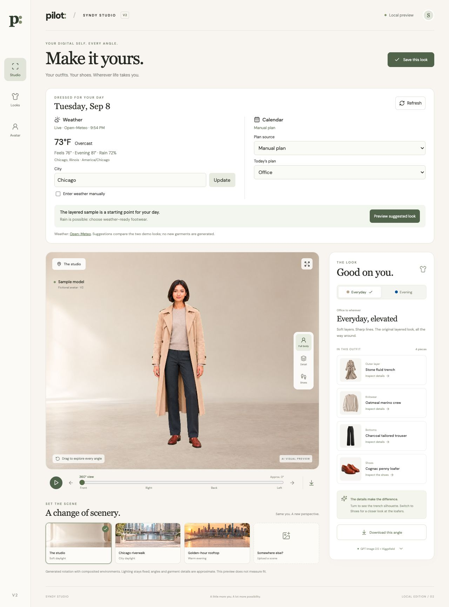
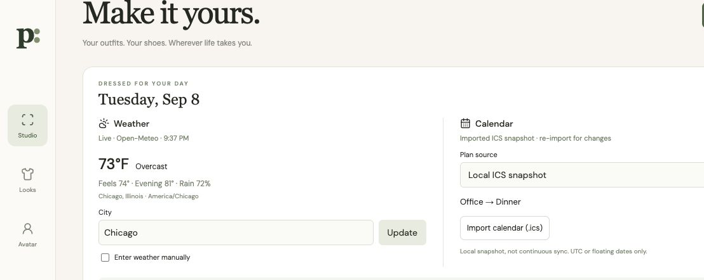
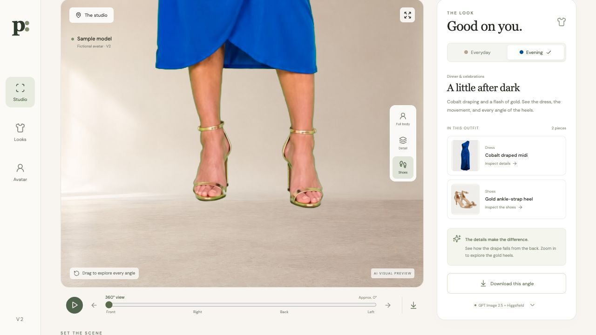
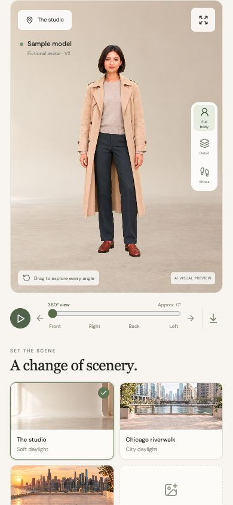

# Pilot · Syndy Studio V2

**Decide what to wear, then inspect the outfit from every angle.**

Pilot combines wardrobe availability, daily weather, calendar context and wear history. Syndy Studio V2 adds a working fashion viewer with generated 360° footage, outfit and shoe close-ups, custom environments, and downloadable snapshots.

[MIT license](LICENSE) · [Contributing](CONTRIBUTING.md) · [Security](SECURITY.md) · [Studio guide](examples/syndy-v2/README.md)



> The screenshots below are actual local browser captures. The public example includes fictional generated sample models and media. Personal reference photos and Sydney’s private turntable files are not included. The viewer uses generated video, **not a 3D body scan or physical-fit simulation**.

## Start here

| Experience | What you get | Start |
| --- | --- | --- |
| **Syndy Studio V2** | Two rotating outfits, shoes/details, three scenes, background upload, live weather, calendar-aware sample suggestions | `npm run dev:v2` → `http://127.0.0.1:4175` |
| **Pilot wardrobe app** | Today, Week, Closet, outfit boards, History, shopping, guided setup | `npm run dev` → `http://127.0.0.1:3000` |
| **Authenticated Pilot** | Private owned wardrobe, reference storage, Google OAuth and server-authoritative recommendations | Configure Supabase and Google as described below |

The [existing hosted Pilot demo](https://sydney-style-brain.developwithjb.chatgpt.site) is a separate sample experience. This source update does not deploy the new Studio to that site. A localhost link only works on the machine running it.

## Quick start: Studio, no generation keys needed

Requirements: Node.js **22.13+**, npm, and a modern browser with WebGL/video support.

```bash
git clone https://github.com/developwithJB/pilot-daily-decisions.git
cd pilot-daily-decisions
npm ci
npm run dev:v2
```

Open **http://127.0.0.1:4175**. The sample images and turntable clips are bundled; viewing, switching outfits and exporting do not call a generation API or spend credits. Weather needs internet access; manual conditions work without it.

If port 4175 is busy:

```bash
STUDIO_PORT=4176 npm run dev:v2
```

Windows PowerShell: set `$env:STUDIO_PORT="4176"` before `npm run dev:v2`.

## Walk through the Studio

1. **Set your day.** Enter a city or switch to manual weather. Choose a manual occasion, import an ICS snapshot, or use Google sync.
2. **Preview the suggestion.** Weather and today’s calendar categories select between the two prepared looks. Rain/cold produce additional guidance; the app does not invent a new outfit.
3. **Choose Everyday or Evening.** Everyday combines a trench, knit, tailored trousers and loafers. Evening combines a cobalt dress and gold heels.
4. **Rotate.** Drag horizontally, move the angle slider, use arrow keys, select Front/Right/Back/Left, or press Play. Labels are approximate video positions.
5. **Inspect details.** Full body shows the entire look; Detail and Shoes zoom in. Garment cards jump to the relevant close-up.
6. **Change the setting.** Select the studio, riverwalk or rooftop. Upload a JPG, PNG or WebP under 15 MB to use any scene image as the background. Uploaded scenes stay in the browser session.
7. **Save or download.** Save this look remembers the outfit and preset scene on this device. Download exports the current angle, zoom and background as a PNG. Custom backgrounds are not saved across reloads.
8. **Expand.** Open the larger viewer; press Escape to exit.



## Daily weather

The Studio reuses `lib/providers/weather-provider.ts`, the same provider used by Pilot’s weather endpoint.

- Default city: Chicago. Enter another city and press **Update**.
- Forecasts come from [Open-Meteo](https://open-meteo.com/) with no key required for its free non-commercial service. Check the provider’s terms for commercial deployments.
- Displays temperature, feels-like temperature, evening conditions, rain probability, resolved location and timezone.
- Refreshes every **15 minutes while the Studio is open**, or immediately with **Refresh**.
- Forecast timestamps use Unix seconds and are formatted in the forecast location’s timezone, rather than assuming the computer is in the same timezone.
- A failed request is shown as unavailable; enter manual temperature/rain instead. Manual weather is explicitly labeled.

The Studio compares two sample looks. This is separate from Pilot’s owned-wardrobe recommendation engine and is not a claim that every sample shoe is suitable for rain or every outfit for an activity.

## Calendar: three explicit modes

| Mode | Setup | Behavior |
| --- | --- | --- |
| **Manual plan** | Choose Office, Dinner, Travel, etc. | Uses that occasion today; no external calendar access |
| **Local ICS snapshot** | Import a `.ics` file under 2 MB | Parses categories and times locally; re-import when the calendar changes |
| **Google Calendar sync** | Running authenticated Pilot backend + configured Google OAuth | Reads the existing `/api/calendar` endpoint; refreshes every 5 minutes while open and on window focus |

ICS import discards raw titles, descriptions, guests and locations after normalization. UTC, all-day and floating timestamps are supported. Recurrence rules and named `TZID` zones are rejected in the Studio importer instead of silently giving incorrect dates; use Google sync or export expanded UTC events. The current import stays in memory, not durable storage. An ICS snapshot is **not** a continuously synced calendar.

Today’s events are grouped in the selected weather location’s timezone (or the device timezone without weather). All-day end dates are exclusive. Floating ICS times follow the device timezone. Multi-day and overnight events are included on the days they overlap.

### Connect Google Calendar

1. Copy `.env.example` to `.env.local` in the **repository root**.
2. Configure a Supabase project; apply migrations `0001` through `0005_professional_product_foundation.sql`. Follow [the migration guide](docs/MIGRATIONS.md).
3. Set the Supabase URL and publishable/anon key. Use the service-role key only for server-side operator tasks, such as inviting a user.
4. Enable the **Google Calendar API**, create a Web OAuth client, and configure its consent screen/test users. Add this exact authorized redirect URI for local use:
   `http://127.0.0.1:3000/api/calendar/callback`
5. Set the server environment:

```env
NEXT_PUBLIC_ROADMAP_BUNDLE_ENABLED=true
NEXT_PUBLIC_SUPABASE_URL=your-project-url
NEXT_PUBLIC_SUPABASE_PUBLISHABLE_KEY=your-publishable-key
GOOGLE_CLIENT_ID=your-client-id
GOOGLE_CLIENT_SECRET=your-client-secret
GOOGLE_REDIRECT_URI=http://127.0.0.1:3000/api/calendar/callback
CALENDAR_TOKEN_ENCRYPTION_KEY=your-base64-encoded-32-byte-key
PILOT_SITE_URL=http://127.0.0.1:3000
LIVE_TRY_ON_ENABLED=false
```

Generate a token-encryption key with `openssl rand -base64 32`. Store it only in `.env.local` or your secret manager. Configure Supabase’s Site URL and allowed auth redirect `http://127.0.0.1:3000/auth/callback` too.

6. Invite the approved user with the existing operator command (`npm run invite -- user@example.com`, with server credentials configured).
7. Run the backend and Studio in separate terminals:

```bash
# Terminal 1: Pilot backend / sign-in
npm run dev

# Terminal 2: Studio, using that backend
PILOT_BACKEND_ORIGIN=http://127.0.0.1:3000 npm run dev:v2
```

8. In Studio choose **Google Calendar sync**, use **1. Sign in to Pilot**, then **2. Connect Google**. Return to Studio and press **Refresh**. Use **127.0.0.1 consistently** for both apps; mixing it with `localhost` separates the cookies.

The Vite server proxies `/api/calendar` to the configured backend and forwards the signed-in session. Google credentials and encrypted refresh tokens remain server-side. Studio displays **Live · Google** only after a connected response succeeds. Without sign-in, configuration, or a reachable backend it shows an actionable status instead of sample events.

Real-account Google OAuth requires your own configured account; it is not enabled by cloning the repository. The public CI verifies the API contract and unauthenticated boundary, not a private Google account.

The current backend reads the primary Google calendar, expands recurring events, and returns up to 50 upcoming events over seven days. Events that have already ended are excluded from that feed.

## Screenshots





Capture notes and scenarios: [screenshots](docs/screenshots/syndy-v2/README.md).

## How the generated viewer works

1. **GPT Image 2.5** produces the full-body outfit stills and environment images.
2. **Seedance 2.5 on Higgsfield** produces a complete turntable clip from each outfit still.
3. A **WebGL chroma-key compositor** removes the green backdrop in the browser.
4. The viewer seeks through the clip for rotation, composites the chosen setting, and exports the current frame.

The bundled examples are generated assets, not real-time try-on. Their front, side and back details may differ from real garments. Background uploads do not relight the model or add 3D geometry. Each additional outfit needs a new render; selecting a garment card only changes inspection focus.

See [the media generation guide](examples/syndy-v2/README.md#using-your-own-media) for the file contract and prompts. The Higgsfield connector used to author assets is not a runtime dependency or a hidden in-browser API integration.

## Run the full wardrobe app

```bash
cp .env.example .env.local
npm run dev
```

Keep the checked-in preview flags until production services are configured:

```env
NEXT_PUBLIC_DEMO_MODE=true
NEXT_PUBLIC_ROADMAP_BUNDLE_ENABLED=false
TRY_ON_PROVIDER=mock
LIVE_TRY_ON_ENABLED=false
```

| Route | Purpose |
| --- | --- |
| `/` | Today’s daily decision and shopping entry point |
| `/week` | Rolling seven-day outfit plan |
| `/try-on` | Exact garment builder and verification board |
| `/closet` | Garment entry, bulk scan, laundry and removal |
| `/history` | Saved wear snapshots and feedback |
| `/onboarding` | Five-stage guided setup |
| `/settings/connections` | Weather, calendar, photo and wardrobe setup |
| `/settings/model` | Private reference-photo controls |
| `/avatar` | Separate generic Three.js fixture, not the Studio video viewer |

Authenticated Pilot filters for owned/available garments before ranking weather, occasion, formality, rotation and feedback. Demo starter garments are labeled samples and are never silently written into a user’s private wardrobe.

## Build and test

```bash
npm run check       # typecheck, lint, app build + unit/integration tests, Studio build
npm run test:e2e    # existing Pilot browser suite (desktop + mobile)
npm run build:v2
npm run preview:v2  # serves Studio build, including calendar proxy
```

Studio build output: `work/syndy-v2/build`. A raw static host must supply its own authenticated `/api/calendar` reverse proxy for Google sync; Vite’s proxy is not included in static JavaScript. Weather/manual/ICS and the media viewer work without that backend.

Validation for this update: 32 unit/integration tests; 16 Pilot browser tests passed with 2 invite-only tests skipped in preview mode; local Studio checks for live weather, normalized ICS plans, outfit selection, rotation, mobile layout and snapshots. See [TESTING.md](TESTING.md) for the production/invite rehearsal.

## Security, privacy and deployment

- Supabase sessions are validated server-side; client-supplied identities are not trusted.
- Private garment/reference/result media uses private Storage and short-lived signed URLs.
- Calendar OAuth is read-only and refresh tokens are encrypted server-side.
- Personal photos, tokens, `.env.local`, local captures of private data and generation manifests must not be added to public source.
- The bundled Studio sample media is public. Replacing it with your own likeness makes that likeness available to anyone who can access that deployment.
- Run the documented isolation, retention and deletion gates before enabling private production features or live AI generation.

This push updates source and documentation. It does not publish a hosted Studio, enable paid generation, or connect anyone’s Google account.

## Project map and further reading

- `examples/syndy-v2/` — standalone Studio, bundled sample assets and media guide
- `app/SydneyApp.tsx` — main Pilot interface
- `lib/providers/` — weather, calendar and media provider contracts
- `lib/outfit-engine.ts` — owned-wardrobe recommendations
- `tests/syndy-v2.test.mjs` — day boundaries, forecast timezone and Google contract tests
- [Architecture](docs/COMBINED_LAUNCH.md) · [Provider development](docs/PROVIDER_DEVELOPMENT.md)
- [Privacy/retention](docs/PRIVACY_RETENTION.md) · [Migrations](docs/MIGRATIONS.md)
- [Release notes](docs/RELEASE_NOTES.md) · [Contributing](CONTRIBUTING.md)
